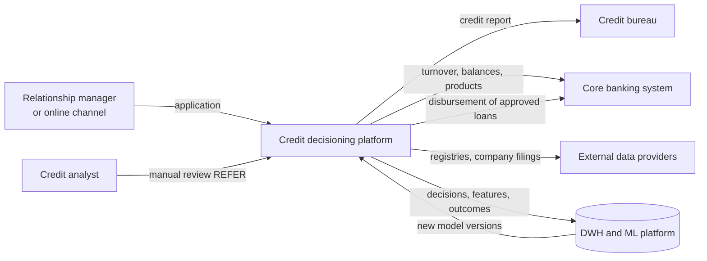
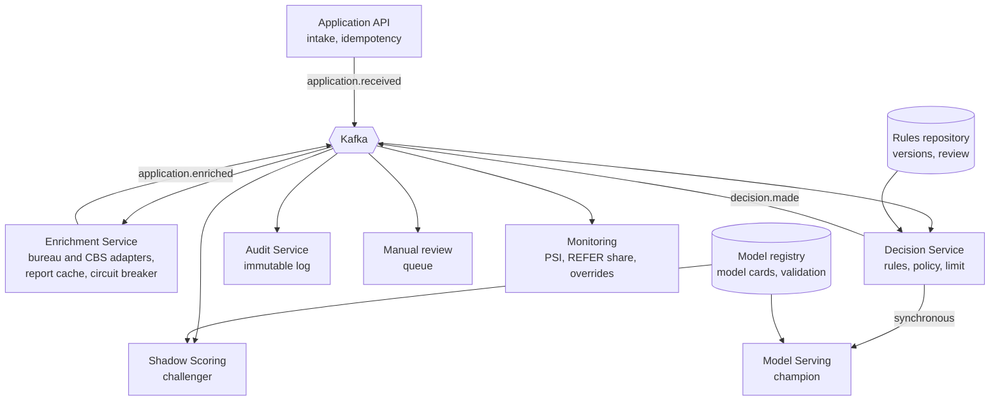
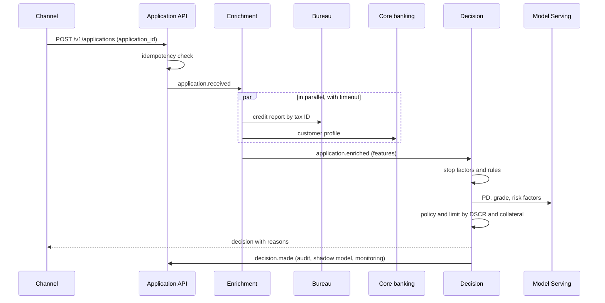
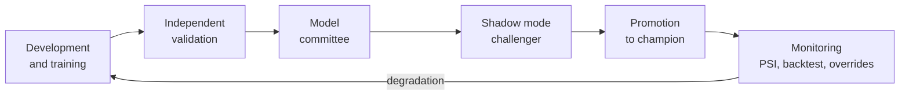

# Architecture: from demo to production platform

**English** | [Русский](ARCHITECTURE.ru.md)

The demo runs in a single process, but it is split into the same components as the target microservice architecture. The event bus in code mirrors Kafka topics, integrations follow the ports-and-adapters pattern, and rules and models are versioned separately from code.

## 1. Context (C4, level 1)

## 2. Containers (C4, level 2)

| Component in the demo | Service in the target architecture |
|---|---|
| `models.Application`, `app.py` | Application API |
| `integrations.py` | Enrichment Service with an adapter per bureau and core banking system |
| `rules.py`, `config/rules.yaml` | Decision Service and rules repository |
| `scoring.py`, `models/*.json` | Model Serving and model registry |
| `engine._shadow_challenger` | Shadow Scoring, a separate subscriber |
| `audit.py` | Audit Service with immutable storage |
| `monitoring.py` | Monitoring, regular stability reports |
| `events.py` | Kafka |

## 3. Processing an application

Target time for an automated decision: under 3 seconds for 95% of applications. The slowest part is the bureau response, so it is called in parallel with core banking and bounded by a timeout.

## 4. Events

| Topic | Key | Payload | Subscribers |
|---|---|---|---|
| `credit.application.received` | application_id | application | Enrichment |
| `credit.application.enriched` | application_id | application, bureau and core banking data, features | Decision |
| `credit.decision.made` | application_id | decision, ruleset and model versions, reasons | Audit, Shadow, Monitoring, manual review queue, disbursement |
| `credit.shadow.scored` | application_id | challenger score, agreement with champion | Monitoring, model validation |

Keying by application_id guarantees the order of one application's events within a partition. Event schemas are kept in a schema registry with backward-compatibility checks, so a format change by one service does not break subscribers. For reliable publication of decisions an outbox is used: the decision and the event are written in one transaction to the service database, and a separate process moves the event to Kafka.

## 5. Integration patterns

| Pattern | Why | In the demo |
|---|---|---|
| Timeout and bounded retries | the bureau responds in seconds; an application must not hang | `resilient_call` |
| Circuit breaker | when the bureau fails, do not hammer it with retries or wait for a timeout on every application | `CircuitBreaker`, test with a fake clock |
| Fail-safe | a data source or model failure leads to manual review, never to approval | test `test_bureau_failure_never_auto_approves` |
| Idempotency | resubmitting an application creates neither a second decision nor a second bureau inquiry | test `test_idempotent_resubmission` |
| Bureau report cache | a bureau inquiry costs money and appears in the credit history; a repeat application within a short period reuses the stored report | described, not implemented |
| Ports and adapters | changing the bureau or core banking system changes an adapter, not the engine | `BureauClient`, `CoreBankingClient` |
| Outbox | consistency between the decision database and events | described, not implemented |

## 6. Non-functional requirements

| Requirement | Solution |
|---|---|
| Decision within 3 s for 95% of applications | parallel calls, timeouts, bureau cache, model in service memory |
| Availability | stateless services in Kubernetes, scaling on Kafka consumer lag |
| Reproducible decisions | the audit stores input hash, ruleset version, model version, features |
| Data minimization | tax ID in the log only as a hash, full data in a protected application store |
| Policy changes without a release | rules in YAML through review and ruleset versioning, validation at load time |
| Explainability | each feature's contribution to the decision, reasons in analyst language |

## 7. Model risk management

- **Versioning.** A model is stored with its version, training date, holdout metrics and feature distributions for monitoring.
- **Shadow mode.** A new version scores the real application flow without affecting decisions. Promotion to champion follows the comparison and a committee decision.
- **Monitoring.** PSI per feature, share of manual reviews, share of analyst decisions against the model (overrides), actual default rate per grade.
- **Regulation.** Scoring of legal entities is not on the EU AI Act list of high-risk AI systems: Annex III covers creditworthiness assessment of natural persons. If the engine were applied to sole proprietors and individuals, high-risk requirements would apply: risk management, data quality, documentation, human oversight. For a bank, any scoring model remains subject to model risk management (reference: US Federal Reserve guidance SR 11-7) and the national regulator's requirements.

## 8. Not implemented in the demo

- real bureau and core banking adapters, credit report cache, outbox;
- separate services and Kafka instead of an in-process bus;
- a credit analyst interface and recording of their decisions (overrides);
- training on real data: the models are trained on a synthetic portfolio.
