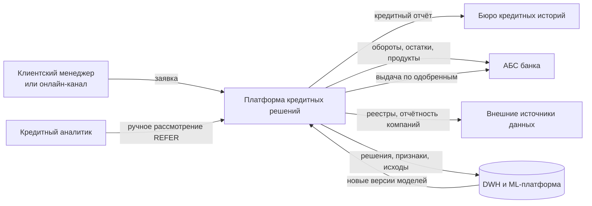
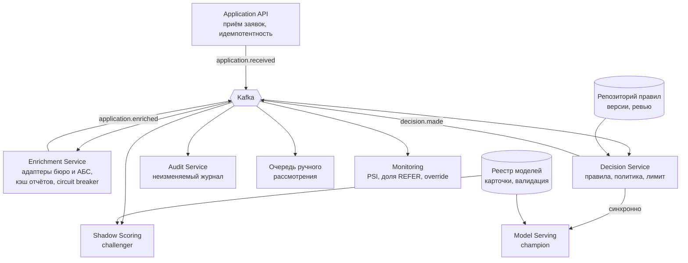
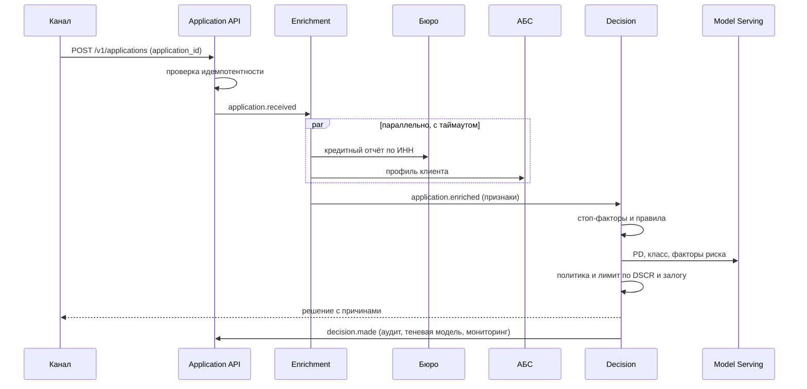
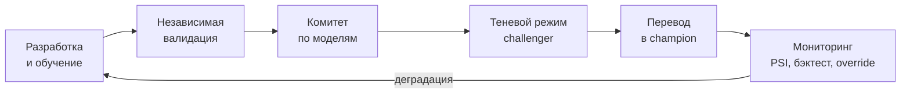

# Архитектура: от демо к промышленной платформе

[English](ARCHITECTURE.md) | **Русский**

Демо работает в одном процессе, но разделено на те же компоненты, что и целевая микросервисная архитектура. Шина событий в коде повторяет топики Kafka, интеграции оформлены как порты и адаптеры, правила и модели версионируются отдельно от кода.

## 1. Контекст (C4, уровень 1)

## 2. Контейнеры (C4, уровень 2)

| Компонент в демо | Сервис в целевой архитектуре |
|---|---|
| `models.Application`, `app.py` | Application API |
| `integrations.py` | Enrichment Service с адаптерами под каждое бюро и АБС |
| `rules.py`, `config/rules.yaml` | Decision Service и репозиторий правил |
| `scoring.py`, `models/*.json` | Model Serving и реестр моделей |
| `engine._shadow_challenger` | Shadow Scoring, отдельный подписчик |
| `audit.py` | Audit Service с неизменяемым хранилищем |
| `monitoring.py` | Monitoring, регулярные отчёты по стабильности |
| `events.py` | Kafka |

## 3. Обработка заявки

Целевое время автоматического решения: до 3 секунд для 95% заявок. Самая долгая часть: ответ бюро, поэтому его вызов параллелится с АБС и ограничен таймаутом.

## 4. События

| Топик | Ключ | Содержимое | Подписчики |
|---|---|---|---|
| `credit.application.received` | application_id | заявка | Enrichment |
| `credit.application.enriched` | application_id | заявка, данные бюро и АБС, признаки | Decision |
| `credit.decision.made` | application_id | решение, версии правил и модели, причины | Audit, Shadow, Monitoring, очередь ручного рассмотрения, выдача |
| `credit.shadow.scored` | application_id | оценка challenger, совпадение с champion | Monitoring, валидация моделей |

Ключ application_id гарантирует порядок событий одной заявки в одной партиции. Схемы событий хранятся в реестре схем с проверкой обратной совместимости, чтобы изменение формата одним сервисом не ломало подписчиков. Для надёжной публикации решения используется outbox: решение и событие записываются в одной транзакции в базу сервиса, а отдельный процесс переносит событие в Kafka.

## 5. Интеграционные паттерны

| Паттерн | Зачем | В демо |
|---|---|---|
| Таймаут и ограниченные повторы | бюро отвечает секундами, заявка не должна висеть | `resilient_call` |
| Circuit breaker | при сбое бюро не нагружать его повторами и не ждать таймаута на каждой заявке | `CircuitBreaker`, тест с часами |
| Безопасный отказ | сбой источника или модели ведёт к ручному рассмотрению, а не к одобрению | тест `test_bureau_failure_never_auto_approves` |
| Идемпотентность | повторная отправка заявки не создаёт второе решение и второй запрос в бюро | тест `test_idempotent_resubmission` |
| Кэш отчётов бюро | запрос в бюро платный и виден в кредитной истории; повторная заявка за короткий срок использует сохранённый отчёт | описано, не реализовано |
| Порты и адаптеры | смена бюро или АБС меняет адаптер, а не движок | `BureauClient`, `CoreBankingClient` |
| Outbox | согласованность базы решений и событий | описано, не реализовано |

## 6. Нефункциональные требования

| Требование | Решение |
|---|---|
| Время решения до 3 с для 95% заявок | параллельные вызовы, таймауты, кэш бюро, модель в памяти сервиса |
| Доступность | stateless-сервисы в Kubernetes, масштабирование по отставанию консьюмеров Kafka |
| Воспроизводимость решения | в аудите хэш входа, версия правил, версия модели, признаки |
| Минимизация данных | ИНН в журнале только в виде хэша, полные данные в защищённом хранилище заявок |
| Изменение политики без релиза | правила в YAML через ревью и версию набора, валидация при загрузке |
| Объяснимость | вклад каждого признака в решение, причины на языке аналитика |

## 7. Управление модельным риском

- **Версионирование.** Модель хранится с версией, датой обучения, метриками на отложенной выборке и распределениями признаков для мониторинга.
- **Теневой режим.** Новая версия оценивает реальный поток заявок, но не влияет на решения. Перевод в основную модель происходит по результатам сравнения и решению комитета.
- **Мониторинг.** PSI по каждому признаку, доля ручных рассмотрений, доля решений аналитиков вопреки модели (override), фактический дефолт по классам.
- **Регулирование.** Скоринг юридических лиц не входит в перечень систем ИИ высокого риска EU AI Act: Annex III относится к оценке кредитоспособности физических лиц. Если движок применять к индивидуальным предпринимателям и физическим лицам, действуют требования к системам высокого риска: управление рисками, качество данных, документирование, человеческий контроль. Для банка любая скоринговая модель остаётся объектом управления модельным риском (ориентир: руководство SR 11-7 ФРС США) и требований национального регулятора.

## 8. Что не реализовано в демо

- реальные адаптеры бюро и АБС, кэш кредитных отчётов, outbox;
- отдельные сервисы и Kafka вместо шины в одном процессе;
- интерфейс кредитного аналитика и фиксация его решений (override);
- обучение на реальных данных: модели обучены на синтетическом портфеле.
